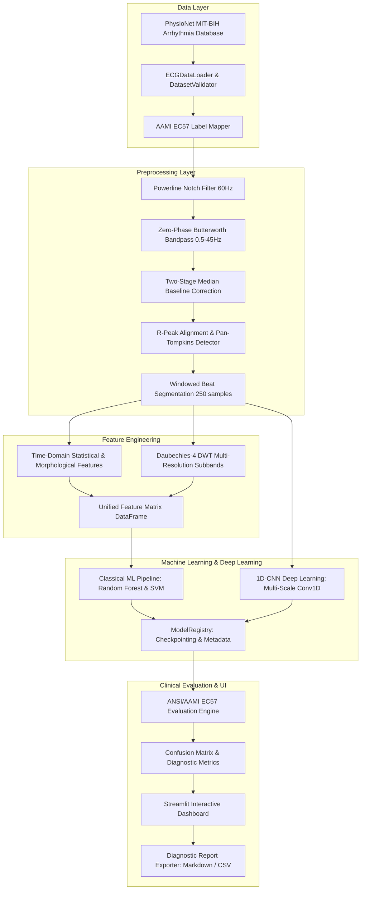

# System Architecture: AI-Based ECG Signal Analysis

## 1. Architectural Philosophy
The **ECG Cardian** platform is designed following strict **modular separation of concerns**, reproducible scientific computing standards, and the ANSI/AAMI EC57 biomedical guidelines. The business logic is strictly decoupled from the presentation layer (Streamlit UI), runtime configuration, and persistence mechanisms.



---

## 2. Component Directory Structure

```
ecg-cardian/
├── app.py                      # Streamlit application entrypoint
├── config/
│   ├── __init__.py
│   └── settings.py             # Central dataclass configuration with env overrides
├── src/ecg_analysis/
│   ├── data/                   # Dataset loading, WFDB interface, validation, AAMI mapping
│   ├── preprocessing/          # Bandpass, notch, median baseline drift, Pan-Tompkins
│   ├── features/               # Statistical, morphological, and DWT multi-resolution features
│   ├── models/                 # Classical ML (Random Forest, SVM), 1D-CNN, Registry, Inference
│   ├── evaluation/             # Clinical metrics (Sens, Spec, PPV, F1), confusion matrix, reporting
│   └── utils/                  # Structured logging, custom exceptions, pathlib path resolvers
├── ui/                         # Streamlit tabs, visualizations, KPI cards, medical disclaimers
├── scripts/                    # CLI utilities: download, prepare, train, evaluate, check_env
├── tests/                      # 47 automated unit and regression tests (pytest)
└── docs/                       # Comprehensive academic documentation
```

---

## 3. Data Flow and Invariance Guarantees
1. **Zero Data Leakage**: In Classical ML pipelines, the `StandardScaler` is wrapped strictly within a `scikit-learn.pipeline.Pipeline`, ensuring test and validation folds are never leaked into training feature distributions.
2. **Deterministic Preprocessing**: All digital filters (`scipy.signal.filtfilt`) are zero-phase forward-backward filters, ensuring zero phase shift in the cardiac P-QRS-T complex.
3. **Safe Serialization**: PyTorch deep learning models are saved and restored using `torch.save(model.state_dict())` and loaded with `weights_only=True`, completely eliminating Python pickle deserialization vulnerabilities.
